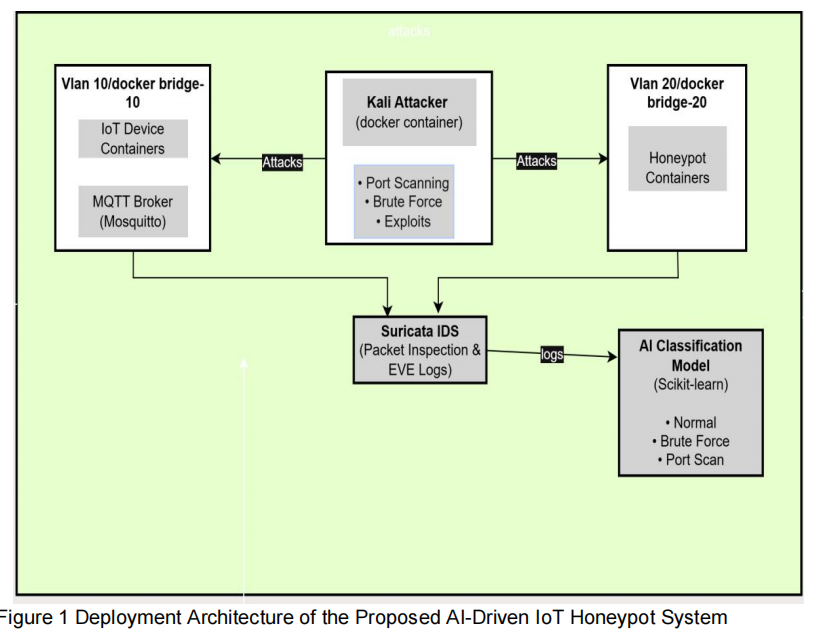
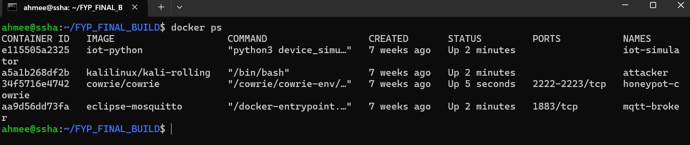
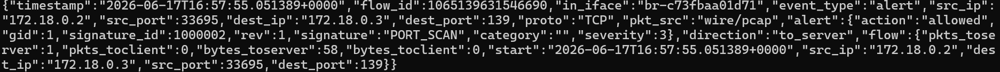
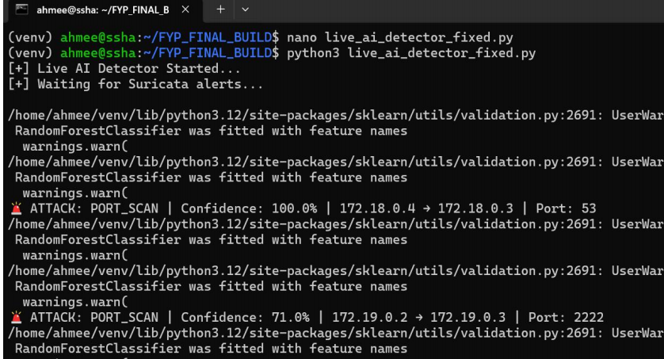

# AI-Driven Virtual IoT Honeypot Network with Suricata-Based Intrusion Detection System

## Overview

This project is an AI-Driven IoT Honeypot Threat Detection System developed as a Final Year Project (BS Information Technology).

The system simulates IoT devices, detects attacks using Suricata IDS, and classifies threats using a Random Forest Machine Learning Model.

## Features

* IoT Device Simulation
* Docker-Based Environment
* Suricata IDS Integration
* Port Scan Detection
* SSH Brute Force Detection
* MQTT Abuse Detection
* Machine Learning Threat Classification
* Confidence Score Generation
* Real-Time Alert Monitoring

## Architecture Diagram



## System Demonstration

### Docker-Based IoT Environment



### Suricata IDS Alert Detection



### AI-Based Threat Classification



## Technologies Used

* Python
* Docker
* Ubuntu Server
* Suricata IDS
* Scikit-Learn
* Random Forest Classifier
* MQTT
* JSON

## AI Features

The AI model uses:

* Protocol
* Source Port
* Destination Port
* Severity
* Packet Count
* Byte Count

to classify:

* Port Scan
* SSH Brute Force
* MQTT Abuse

## Project Structure

```text
dataset_generator_fixed.py
device_simulator.py
eve_to_csv_fixed.py
train_model_fixed.py
live_ai_detector_fixed.py
config.json
```

## Future Improvements

* Wazuh Integration
* Threat Intelligence Integration
* Anomaly Detection
* Grafana Dashboard
* Additional Attack Categories
* Large Scale IoT Environment

## Author

Muhammad Ahmad

BS Information Technology

Government Graduate College Samnabad Faisalabad

GitHub:
https://github.com/AhmeeMian645

```
```
