# AI-Driven Virtual IoT Honeypot with Suricata IDS and Wazuh SIEM

Final Year Project (BS Information Technology), extended in **v2.0** with a Wazuh SIEM integration.

## Overview
A safe, virtual IoT security lab. Attacks on simulated IoT devices (port scan, SSH brute force, MQTT flood) are **detected by Suricata**, **classified by a Random Forest model**, and shown to an analyst in a **Wazuh dashboard** with severity levels and MITRE ATT&CK tags.

**Objective:** build a controlled environment where IoT attacks can be simulated, detected, classified, and analyzed.
**Scope:** the system detects, classifies, and displays attacks. It does **not** block them (Suricata runs as an IDS, not an IPS).

## Versions
| Version | What it is |
|---|---|
| **v1.0** | The original final-year project: Docker IoT lab, custom Suricata rules, Random Forest classifier, live terminal output |
| **v2.0** | Adds the Wazuh integration: both Suricata and AI alerts in one dashboard, custom Wazuh rules with severity and MITRE tags, JSON output from the AI detector, and a fix for a rule false positive |

Details: [CHANGELOG.md](CHANGELOG.md)

## Architecture
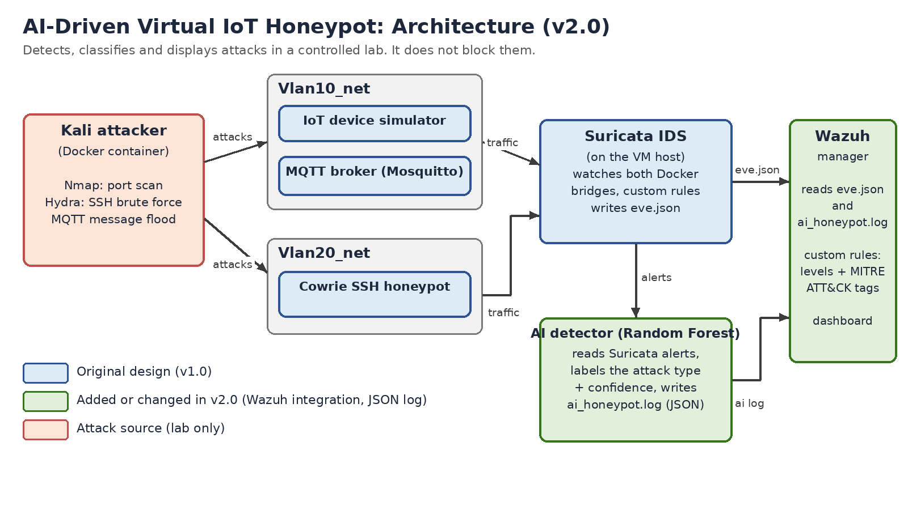

1. A Kali container attacks the lab (Nmap, Hydra, MQTT flood).
2. Suricata watches both Docker networks and writes alerts to `eve.json`.
3. The AI detector follows `eve.json`, labels each alert (PORT_SCAN, SSH_BRUTE_FORCE, MQTT_ABUSE) with a confidence score, and writes the result as JSON to `ai_honeypot.log`.
4. The Wazuh manager reads both files. Custom rules assign severity and MITRE ATT&CK tags.
5. The analyst sees everything in the Wazuh dashboard.

## Results
**Suricata and AI alerts in one Wazuh dashboard**
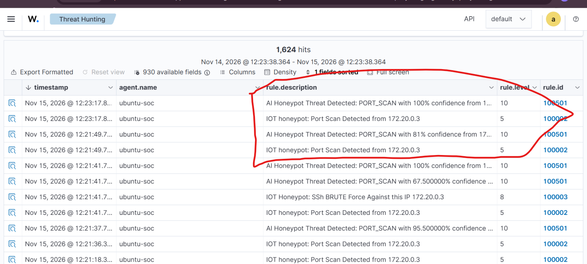

**Custom Wazuh rules: before and after**
Wazuh gave every Suricata alert the same generic level 3. Custom rules now set a severity and an ATT&CK technique per attack.

| Before (all level 3) | After (custom levels, MITRE tags) |
|---|---|
| 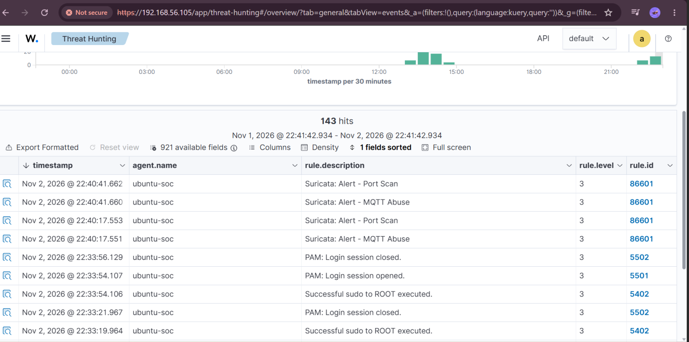 | 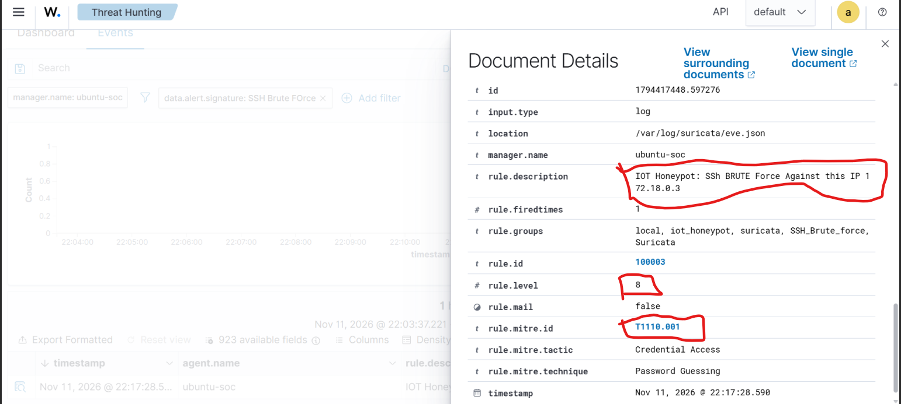 |

| Attack | Wazuh rule | Level | MITRE ATT&CK |
|---|---|---|---|
| Port scan | 100002 | 5 | T1046 Network Service Discovery |
| SSH brute force (honeypot, port 2222) | 100003 | 8 | T1110.001 Password Guessing |
| MQTT flood (broker, port 1883) | 100004 | 8 | T1499.002 Service Exhaustion Flood |
| AI classification (any label) | 100501 | see rules file | Not tagged: a supporting opinion on the same event |

Rules: [`wazuh/local_rules.xml`](wazuh/local_rules.xml)

**AI detector live output** (the JSON that Wazuh reads)
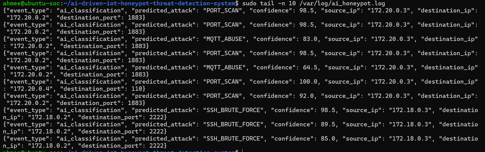

**Wazuh configuration** (two `localfile` blocks: `eve.json` and `ai_honeypot.log`)
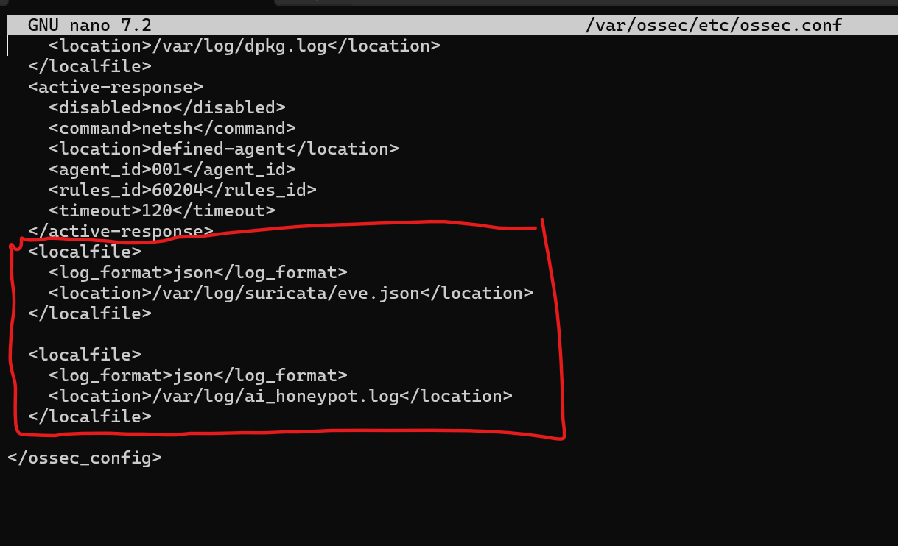

## A problem I found and fixed
My Port Scan rule counted SYN packets per source IP (15 in 5 seconds), not distinct ports. A fast MQTT flood opens many connections, so it also triggered the port-scan alert.

| Before | After |
|---|---|
| 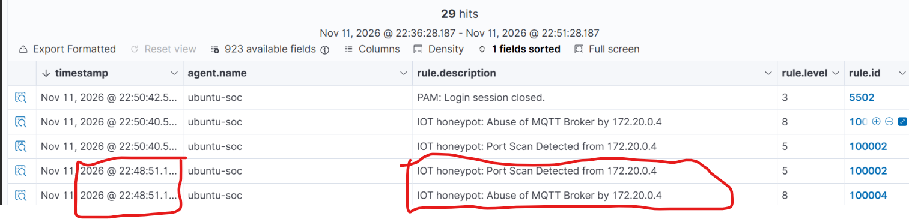 | 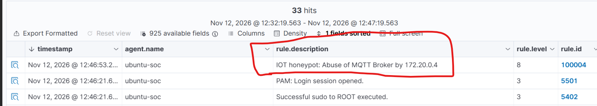 |

**Fix:** the Port Scan rule now excludes port 1883 (`suricata/local.rules`). A better design would count distinct destination ports.

## Known limitations
- **The AI only sees alerts Suricata already raised.** It labels them from six numeric features and adds a confidence score. It does not find attacks Suricata misses.
- **Mislabels on port 1883.** In my training data, port-1883 events appear with both MQTT_ABUSE and PORT_SCAN labels but identical feature values (a side effect of the old rule overlap), so the model sometimes calls an MQTT flood a port scan.
  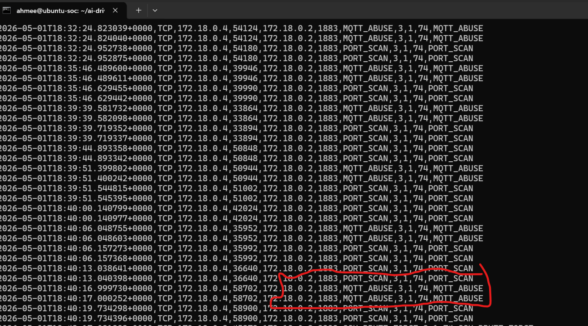
- **Weak features.** Severity, packet count, and byte count are nearly constant in my data, so the destination port carries most of the signal.
- **No "normal" or "other" class.** Low-confidence outputs (for example IPv6 background traffic) should be treated as unreliable.
- **Simulated attacks and a small, generated dataset.** Not tested on real traffic. I do not claim a real-world accuracy figure.
- **Detection only.** Nothing is blocked.

**Next steps:** relabel the data, add features such as connection rate and distinct ports per source, add a "normal" class, and evaluate on traffic the model has not seen.

## Quick start
These steps rebuild the lab on one Ubuntu Server VM (8 GB RAM recommended if Wazuh runs on the same VM).

**1. Get the code**
```bash
git clone https://github.com/AhmeeMian645/ai-driven-iot-honeypot-threat-detection-system.git
cd ai-driven-iot-honeypot-threat-detection-system
python3 -m venv .venv && source .venv/bin/activate
pip install -r requirements.txt pandas
```

**2. Create the Docker lab** (needs Docker)
```bash
sudo bash docker/setup.sh
sudo docker ps
```
Expected: `attacker`, `mqtt_broker`, `iot-simulator`, and `honeypot-cowrie` running on networks `Vlan10_net` and `Vlan20_net`.
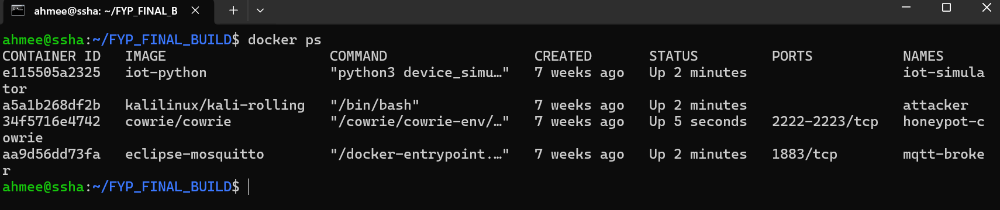

**3. Install Suricata and load the rules**
```bash
sudo apt update && sudo apt install -y suricata
sudo cp suricata/local.rules /var/lib/suricata/rules/local.rules
```
Make sure `local.rules` is listed under `rule-files:` in `/etc/suricata/suricata.yaml`, then test it:
```bash
sudo suricata -T -c /etc/suricata/suricata.yaml
```

**4. Start Suricata on both Docker bridges**
```bash
B10="br-$(sudo docker network inspect Vlan10_net -f '{{.Id}}' | cut -c1-12)"
B20="br-$(sudo docker network inspect Vlan20_net -f '{{.Id}}' | cut -c1-12)"
sudo suricata -c /etc/suricata/suricata.yaml -i $B10 -i $B20
```

**5. Start the AI detector** (in a second terminal, from the repo folder)
```bash
sudo touch /var/log/ai_honeypot.log && sudo chown $USER /var/log/ai_honeypot.log
source .venv/bin/activate
python3 live_ai_detector_fixed.py
```

**6. Run the attacks** (example commands; adapt the IPs)
```bash
sudo docker exec -it attacker bash
apt update && apt install -y nmap hydra mosquitto-clients
# port scan:        nmap -sS <TARGET_IP>
# SSH brute force:  hydra -l root -P <WORDLIST> -s 2222 ssh://<COWRIE_IP>
# MQTT flood:       for i in $(seq 1 50); do mosquitto_pub -h <BROKER_IP> -t test -m x; done
```

**7. What you should see**
| Attack | Suricata alert (`/var/log/suricata/eve.json`) | AI detector output |
|---|---|---|
| Port scan | Port Scan | PORT_SCAN with a confidence score |
| SSH brute force | SSH Brute Force | SSH_BRUTE_FORCE with a confidence score |
| MQTT flood | MQTT Abuse | MQTT_ABUSE (sometimes PORT_SCAN, see limitations) |

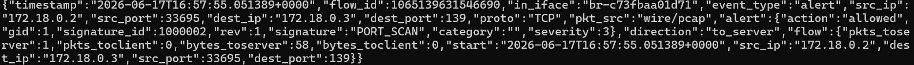
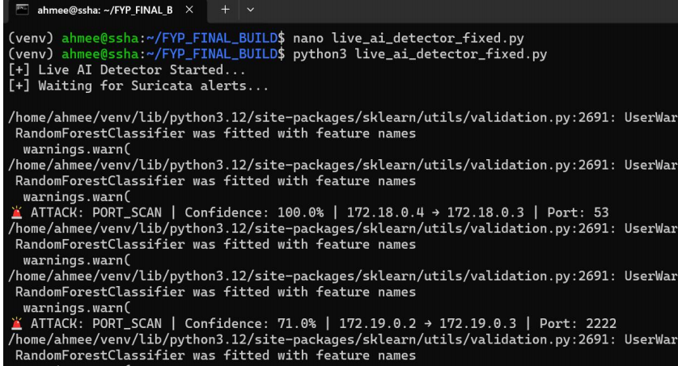

## Wazuh integration (optional)
Tested with **Wazuh 4.14.9**, manager on the same VM.
1. Add the two `<localfile>` blocks from [`wazuh/ossec-localfile-snippet.xml`](wazuh/ossec-localfile-snippet.xml) inside `<ossec_config>` in `/var/ossec/etc/ossec.conf`.
2. Add the rules from [`wazuh/local_rules.xml`](wazuh/local_rules.xml) to `/var/ossec/etc/rules/local_rules.xml`.
3. Test and restart:
   ```bash
   sudo /var/ossec/bin/wazuh-analysisd -t
   sudo systemctl restart wazuh-manager
   ```
4. Run the attacks, then open **Threat Hunting → Events** in the dashboard and search `rule.groups: iot_honeypot` for the Suricata alerts, or `rule.groups: ai_detection` for the AI verdicts.

## Repository structure
```
suricata/local.rules                  custom Suricata rules (port scan, SSH brute force, MQTT abuse)
wazuh/local_rules.xml                 custom Wazuh rules (levels, MITRE tags, AI alert)
wazuh/ossec-localfile-snippet.xml     the two localfile blocks for ossec.conf
docker/setup.sh                       creates the networks and containers
live_ai_detector_fixed.py             live detector: classifies alerts, writes JSON for Wazuh
device_simulator.py, config.json      simulated IoT devices (MQTT)
dataset_generator_fixed.py, eve_to_csv_fixed.py, train_model_fixed.py     dataset and model pipeline
final_dataset.csv, iot_attacks.csv    datasets
iot_attack_model.pkl, label_encoder.pkl, protocol_encoder.pkl     trained model and encoders
CHANGELOG.md                          what changed between v1.0 and v2.0
screenshots/                          evidence
```

## Technologies
Python, scikit-learn (Random Forest), Docker, Ubuntu Server, Suricata IDS, MQTT (Mosquitto), Cowrie SSH honeypot, Kali Linux, Wazuh SIEM, MITRE ATT&CK.

## Note on AI assistance
Parts of the Python code (the model pipeline and the live detector) were written with AI assistants (ChatGPT and Gemini). I designed the lab, wrote the detection rules, ran the attacks, integrated Wazuh, diagnosed the issues described above, and verified the results.

## Author
**Muhammad Ahmad**, BS Information Technology
Government College University Faisalabad (Government Graduate College Samanabad, Faisalabad, affiliated)
GitHub: https://github.com/AhmeeMian645
